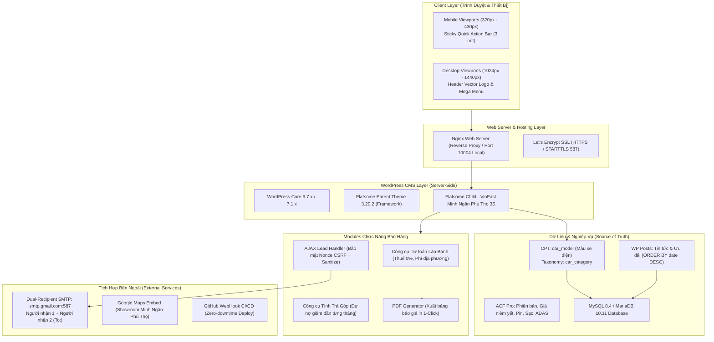
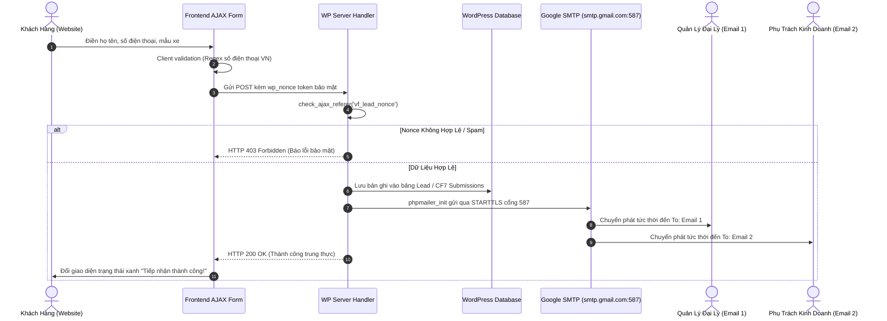

# KIẾN TRÚC HỆ THỐNG WEBSITE VINFAST MINH NGÂN (REBUILD ARCHITECTURE)

> **Tài liệu đặc tả kiến trúc kỹ thuật (Technical Architecture Document)**  
> Được xây dựng bởi Solution Architect & Senior WordPress Developer Team  
> Mục tiêu: Tối ưu hiệu năng, bảo mật, chuẩn hóa dữ liệu ô tô điện, sẵn sàng scale mở rộng.

---

### 1. SƠ ĐỒ KIẾN TRÚC TỔNG THỂ (SYSTEM ARCHITECTURE)



---

### 2. QUY CHUẨN DESIGN SYSTEM & TOKENS (`style.css`)

Website áp dụng chặt chẽ Design Tokens nhận diện thương hiệu VinFast với hệ thống biến CSS đồng bộ:

```css
:root {
  /* Colors */
  --vf-primary:       #2563EB; /* Xanh VinFast chủ đạo theo đặc tả */
  --vf-primary-dark:  #1D4ED8; /* Trạng thái Hover / Focus */
  --vf-primary-light: #EFF6FF; /* Nền nhạt cho Box / Badge */
  --vf-accent-red:    #E8112D; /* Điểm nhấn thông báo / Hotline */
  --vf-text-main:     #0F172A; /* Màu chữ văn bản chính */
  --vf-text-muted:    #64748B; /* Màu chữ phụ / Thông số kỹ thuật */
  --vf-border:        #E2E8F0; /* Đường viền bảng và form */
  --vf-bg-card:       #FFFFFF; /* Nền khối xe và thông số */
  --vf-bg-body:       #F8FAFC; /* Nền tổng thể trang web */

  /* Typography */
  --vf-font-family:   'Mulish', 'Plus Jakarta Sans', system-ui, sans-serif;
  --vf-heading-font:  'Plus Jakarta Sans', var(--vf-font-family);

  /* Spacing & Borders */
  --vf-radius-sm:     4px;
  --vf-radius-md:     8px;
  --vf-radius-lg:     16px;
  --vf-shadow-card:   0 10px 25px -5px rgba(37, 99, 235, 0.08);

  /* Transitions */
  --vf-transition:    all 0.25s cubic-bezier(0.4, 0, 0.2, 1);
}
```

**Responsive Breakpoints chuẩn Mobile-First:**
- Mobile Small: `320px` - `374px` (iPhone SE).
- Mobile Standard: `375px` - `430px` (iPhone 14/15, Samsung Galaxy).
- Tablet: `768px` - `1023px` (iPad Portrait).
- Desktop Compact: `1024px` - `1365px` (iPad Pro / Small Laptops).
- Desktop Standard: `1440px+` (Desktop màn hình rộng).

---

### 3. KIẾN TRÚC THANH ĐIỀU HƯỚNG & GIAO DIỆN CHUYỂN ĐỔI

1. **Header Desktop:**
   - Logo thương hiệu: Vector SVG/PNG chính hãng VinFast Minh Ngân, chiều cao khóa cố định `64px`, tự động căn giữa cân đối.
   - Mega Menu sản phẩm: Phân nhóm 2 cột rõ ràng gồm **Xe Cá Nhân** (VF 2 đến VF 9, VF Wild) và **Green Series** (Minio, Herio, Nerio, Limo Green, EC Van).
   - Nút CTA Header: Nút bấm màu xanh `#2563EB` cố định góc phải: **ĐĂNG KÝ LÁI THỬ** dẫn về `/dang-ky-lai-thu/`.

2. **Sticky Quick Action Bar (Đáy Mobile < 768px):**
   - Thiết kế chuẩn ngón tay cái (Thumb-zone UX), bám sát đáy màn hình điện thoại với đúng **3 nút chức năng thiết yếu**:
     - 📞 **Nút 1: Gọi ngay** (`tel:HOTLINE`) — Nền trắng viền xám, icon điện thoại đỏ/xanh.
     - 🧮 **Nút 2: Dự toán** (`href="/du-toan-chi-phi/"`) — Nền trắng viền xám, icon máy tính tài chính.
     - 🚗 **Nút 3: Lái thử** (`href="/dang-ky-lai-thu/"`) — **Nút nổi bật nhất**, nền xanh VinFast `#2563EB`, chữ trắng in hoa, kích thước chiếm 45% chiều rộng thanh.

3. **Nút nổi Hotline/Zalo & Popup Ưu Đãi:**
   - Nút tròn Zalo & Phone nổi cố định góc phải dưới (trên mobile xếp phía trên thanh Sticky Bar 70px để tránh đè giao diện).
   - Popup Maker: Hiển thị ưu đãi theo trigger (sau 5s truy cập hoặc khi cuộn 50%), tích hợp nút đóng `X` rõ ràng và lưu cookie 24h để không gây phiền khách hàng.

---

### 4. MÔ HÌNH DỮ LIỆU CPT `car_model` & ACF PRO (MỞ RỘNG)

Kiến trúc dữ liệu quản trị ô tô điện được thiết kế độc lập, cho phép người quản trị thay đổi giá bán và thông số mà không phải can thiệp code:

```
CPT: car_model
├── Fields Cơ Bản:
│   ├── Mã dòng xe (slug): vf-3, vf-7, vf-5, vf-8, vfwild...
│   ├── Phân loại: Taxonomy car_category (Xe cá nhân / Xe dịch vụ)
│   ├── Giá niêm yết tối thiểu: base_price (số nguyên, VND)
│   ├── Số chỗ ngồi: seating_capacity (4, 5, 7 chỗ)
│   └── Quãng đường di chuyển tối đa: max_range (km/lần sạc)
├── Fields Kỹ Thuật (ACF Repeater versions):
│   ├── Tên phiên bản: Eco, Plus
│   ├── Giá bán có pin / thuê pin: price_with_battery / price_battery_rent
│   ├── Dung lượng pin (kWh): battery_capacity
│   ├── Công suất động cơ (kW / hp): motor_power
│   ├── Mô-men xoắn (Nm): torque
│   └── Thời gian sạc nhanh (10% - 70%): fast_charge_time
└── Gallery & Màu Sắc (ACF Repeater car_colors):
    ├── Tên màu: Trắng, Đỏ, Xanh, Vàng...
    ├── Mã màu Hex: #FFFFFF, #E8112D...
    └── Ảnh xe tương ứng: car_image_url
```

---

### 5. KIẾN TRÚC LOGIC DỰ TOÁN LĂN BÁNH & TÍNH TRẢ GÓP

1. **Dự Toán Lăn Bánh (Data Contract):**
   - **Đầu vào:** `car_slug`, `version_id`, `province_type` (Hà Nội / TP.HCM / Tỉnh - Phú Thọ).
   - **Quy tắc tính toán (Nguồn: Biểu phí giao thông đường bộ Việt Nam & Ưu đãi xe điện):**
     - *Lệ phí trước bạ xe điện:* **0%** (Áp dụng theo Nghị định của Chính phủ dành cho ô tô điện chạy pin).
     - *Phí cấp biển số:* Hà Nội / TP.HCM: 20.000.000 VNĐ; Tỉnh (Phú Thọ): 1.000.000 VNĐ.
     - *Phí đăng kiểm:* 340.000 VNĐ.
     - *Phí bảo trì đường bộ:* 1.560.000 VNĐ / năm (cá nhân).
     - *Bảo hiểm TNDS bắt buộc:* 480.700 VNĐ (dưới 6 chỗ) hoặc 873.400 VNĐ (6-11 chỗ).
     - *Tổng dự toán:* $\text{Tổng} = \text{Giá xe} + \text{Biển số} + \text{Đăng kiểm} + \text{Đường bộ} + \text{TNDS}$.

2. **Tính Lịch Trả Góp Dư Nợ Giảm Dần:**
   - **Công thức:**
     - $\text{Vốn vay} = \text{Giá xe} \times (1 - \text{Tỷ lệ trả trước})$.
     - $\text{Gốc hàng tháng} = \frac{\text{Vốn vay}}{\text{Số tháng vay}}$.
     - $\text{Lãi tháng thứ } k = \text{Dư nợ còn lại tháng } (k-1) \times \frac{\text{Lãi suất năm}}{12}$.
     - $\text{Tổng thanh toán tháng } k = \text{Gốc} + \text{Lãi tháng thứ } k$.
     - $\text{Dư nợ còn lại tháng } k = \text{Dư nợ tháng } (k-1) - \text{Gốc}$.
   - **Tất toán:** Kỳ cuối cùng dư nợ về đúng $0$ VNĐ.

3. **Xuất Báo Giá PDF 1-Click:**
   - Cơ chế: Tạo template in chuyên nghiệp khổ A4 bằng JavaScript (`window.print` tối ưu CSS `@media print` hoặc thư viện `html2pdf.js` offline đóng gói sẵn).
   - Hiển thị đầy đủ: Header đại lý VinFast Minh Ngân, bảng chi tiết lăn bánh/trả góp, chữ ký tư vấn bán hàng, số Hotline hỗ trợ.

---

### 6. KIẾN TRÚC TIẾP NHẬN LEAD DUAL-RECIPIENT SMTP



---

### 7. KIẾN TRÚC CI/CD TỰ ĐỘNG TRIỂN KHAI (DEVOPS)

1. **Repository:** Quản lý tập trung trên GitHub `dinhdat1503/vinfastminhnganphutho-3s.com.vn`.
2. **aaPanel WebHook Endpoint:** Khi lập trình viên thực hiện `git push origin main`, GitHub tự động gửi tín hiệu WebHook HTTP POST có khóa bí mật (Secret Payload) tới server VPS.
3. **Shell Script Runner trên VPS:**
   ```bash
   #!/bin/bash
   echo "--- BẮT ĐẦU ĐỒNG BỘ MÃ NGUỒN TỰ ĐỘNG ---"
   cd /www/wwwroot/vinfastminhnganphutho-3s.com.vn || exit 1
   git fetch origin main
   git reset --hard origin/main
   chown -R www:www wp-content/themes/flatsome-child-minhnganphutho
   echo "--- ĐỒNG BỘ HOÀN TẤT THÀNH CÔNG ---"
   ```
4. **An Toàn Dữ Liệu:** Script chỉ cập nhật mã nguồn trong theme và code tùy biến, không ghi đè thư mục uploads hay file `wp-config.php` trên máy chủ.

