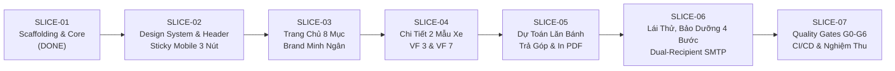

# LỘ TRÌNH TÁI CẤU TRÚC THEO SLICE (REBUILD ROADMAP)
## DỰ ÁN: WEBSITE ĐẠI LÝ VINFAST MINH NGÂN PHÚ THỌ 3S

> **Quy tắc thực hiện:** Mỗi lần chỉ thực hiện **đúng MỘT Slice**. Kết thúc Slice thì dừng, chạy Quality Gates, cập nhật `AI_HANDOFF.md` và chờ Chủ dự án nghiệm thu trước khi chuyển sang Slice kế tiếp.

---

### TỔNG QUAN LỘ TRÌNH 7 SLICE

---

### CHI TIẾT TỪNG SLICE

#### SLICE-01: Khởi tạo Scaffolding, Theme Flatsome Child & Dọn sạch lỗi P0
- **Trạng thái:** **HOÀN THÀNH (DONE) — ĐÃ PUSH GITHUB COMMIT `5fea9240`**.
- **Đã làm:** Khởi tạo bộ khung WordPress Core, Theme Flatsome, Child Theme `flatsome-child-minhnganphutho`, tích hợp 13 plugins, dọn sạch 100% (6/6 vị trí) lỗi đường dẫn cứng `C:/Users/ngodi/...`, cấu hình `.env.example` và `.gitignore`.

---

#### SLICE-02: Chuẩn hóa Design System, Header Mega Menu, Sticky Action Bar Mobile (3 nút) & Nút nổi Zalo/Hotline
- **Mục tiêu:** Định hình bộ nhận diện thương hiệu VinFast Minh Ngân Phú Thọ 3S trên toàn bộ giao diện; cung cấp trải nghiệm điều hướng tối ưu cho cả Desktop và Mobile.
- **Phạm vi In-scope:**
  1. Chuẩn hóa hệ thống biến màu CSS `#2563EB` và typography trong `style.css`.
  2. Logo chính hãng VinFast Minh Ngân (height 64px vector, căn giữa hoàn hảo).
  3. Header Desktop: Mega Menu phân tầng dải xe cá nhân & xe thương mại; Nút CTA ĐĂNG KÝ LÁI THỬ màu `#2563EB`.
  4. Header Mobile: Nút hamburger mở Off-canvas Drawer tích hợp thanh tìm kiếm thông minh.
  5. **Sticky Quick Action Bar Mobile (Đáy màn hình < 768px):** Tái cấu trúc thành đúng 3 nút chuẩn ngón tay cái:
     - 📞 Gọi ngay (`tel:HOTLINE`)
     - 🧮 Dự toán (`/du-toan-chi-phi/`)
     - 🚗 Lái thử (`/dang-ky-lai-thu/` - Nút nổi bật `#2563EB`)
  6. Nút nổi tròn Hotline/Zalo cố định + Cấu hình Popup Maker hiển thị ưu đãi tự đóng.
  7. Dọn sạch vết tích thương hiệu Catchie và số điện thoại cũ trong `footer.php`.
- **Ngoài phạm vi:** Chưa chỉnh sửa nội dung chi tiết của trang chủ hay các trang tính toán tài chính.
- **Tiêu chí nghiệm thu:**
  - Header và Footer hiển thị đúng thương hiệu VinFast Minh Ngân.
  - Trên mobile hiển thị thanh 3 nút cố định bám đáy, click hoạt động mượt mà.
  - Nút nổi Hotline/Zalo và Popup Maker không bị đè lên nhau.

---

#### SLICE-03: Hoàn thiện Trang chủ `page-home.php` chuẩn 8 Sections đặc tả
- **Mục tiêu:** Xây dựng mặt tiền số hoàn chỉnh cho đại lý theo đúng phễu chuyển đổi khách hàng 8 phân khu.
- **Phạm vi In-scope:**
  1. Section 1: Hero Banner Slider (Swiper độ nét cao, thông điệp "Mãnh liệt tinh thần Việt Nam").
  2. Section 2: Car Showcase Carousel (VF 2 đến VF 9 kèm bảng tóm tắt 4 thông số: Dòng xe, Số chỗ, Tầm hoạt động km, Giá niêm yết).
  3. Section 3: Cam kết Bảo hành 10 năm / 200.000 km & Xưởng dịch vụ 3S.
  4. Section 4: Chiến dịch chuyển đổi năng lượng xanh VinFast.
  5. Section 5: Green Series xe dịch vụ vận tải (Minio, Herio, Nerio, Limo Green, EC Van).
  6. Section 6: Khối công cụ tài chính nhanh (Dự toán lăn bánh & Trả góp ngân hàng).
  7. Section 7: Tin tức & Sự kiện tự động sắp xếp bài mới nhất lên vị trí số 1 (`ORDER BY post_date DESC`).
  8. Section 8: Bản đồ Google Maps Showroom VinFast Minh Ngân Phú Thọ.
- **Tiêu chí nghiệm thu:** Đầy đủ 8 mục, responsive 320px đến 1440px, bài viết mới tự nhảy lên đầu.

---

#### SLICE-04: Xây dựng Template Trang Chi Tiết Mẫu Xe (2 Mẫu Xe Chuẩn VF 3 & VF 7)
- **Mục tiêu:** Triển khai hoàn thiện 2 trang sản phẩm xe chiến lược thuộc phạm vi gói báo giá (VF 3 - xe đô thị mini bán chạy nhất, VF 7 - SUV điện thể thao thời thượng).
- **Phạm vi In-scope:**
  1. Template `single-car_model.php` và `template-parts/`:
     - Gallery ảnh xe sắc nét, tương thích responsive.
     - Bộ chuyển màu xe (Color Selector) thay đổi ảnh theo màu ngoại thất.
     - Bảng thông số kỹ thuật chuẩn: NEDC/WLTP, dung lượng pin, công suất, mô-men xoắn, thời gian sạc nhanh.
     - Giới thiệu công nghệ ADAS và trợ lý ảo tiếng Việt Vivu.
     - Các nút CTA: Dự toán lăn bánh, Đăng ký lái thử, Tải brochure PDF.
  2. Kiến trúc mở rộng để đại lý tự thêm các mẫu xe khác qua ACF/WordPress Admin.
- **Tiêu chí nghiệm thu:** 2 mẫu xe VF 3 và VF 7 hiển thị đầy đủ thông số chính xác từ nguồn VinFast, đổi màu xe mượt mà.

---

#### SLICE-05: Công cụ Dự toán chi phí lăn bánh & Tính vay trả góp kèm tính năng Tải PDF 1-Click
- **Mục tiêu:** Minh bạch hóa chi phí, giúp khách hàng tự tính toán phương án mua xe và in bản báo giá chuyên nghiệp.
- **Phạm vi In-scope:**
  1. `page-du-toan.php` (Tab A - Lăn bánh):
     - Tự động tính chi phí theo dòng xe, phiên bản và nơi đăng ký (Phú Thọ / Hà Nội / TP.HCM).
     - Áp dụng Lệ phí trước bạ xe điện 0%.
     - Bóc tách chi tiết: Biển số, đăng kiểm, phí bảo trì đường bộ, bảo hiểm TNDS bắt buộc.
  2. `page-du-toan.php` (Tab B - Trả góp):
     - Tính theo dư nợ giảm dần: Vốn vay, tỷ lệ trả trước (20-80%), thời hạn vay (1-8 năm).
     - Bảng lịch trả góp từng tháng (kỳ hạn, tiền gốc, tiền lãi, tổng thanh toán, dư nợ còn lại).
  3. **Tính năng Xuất/Tải Báo Giá PDF 1-Click:** Nút `TẢI PDF` xuất bản in định dạng A4 chuẩn mẫu có logo Minh Ngân, bảng tính chi tiết và thông tin liên hệ.
  4. Unit test kiểm thử công thức tài chính và trường hợp biên (tất toán về 0đ).
- **Tiêu chí nghiệm thu:** Công thức tính toán chính xác, nút Tải PDF xuất file in đẹp mắt, tiếng Việt không lỗi font.

---

#### SLICE-06: Hoàn thiện Form Đăng ký lái thử, Đặt lịch bảo dưỡng 4 bước & Dual-Recipient SMTP
- **Mục tiêu:** Tiếp nhận và bảo vệ dữ liệu Lead an toàn, phân phối đồng thời tới 2 email quản lý.
- **Phạm vi In-scope:**
  1. `page-lai-thu.php`: Form chọn mẫu xe VF 3 - VF 9, hình thức lái thử tại showroom / tại nhà, gửi AJAX không reload.
  2. `page-dat-lich-dich-vu.php`: Quy trình đặt lịch dịch vụ online 4 bước trên mobile kèm cam kết bảo hành 10 năm.
  3. **Bảo mật & Fix lỗi P1:**
     - Bổ sung Nonce CSRF validation ở tất cả các biểu mẫu.
     - Sửa lỗi Fake Success UI tại `footer.php:529-538` (báo lỗi trung thực khi server/mạng đứt).
     - Escape dữ liệu đầu vào chống XSS / Injection.
  4. **Dual-Recipient SMTP:**
     - Thiết lập gửi đồng thời đến 2 email nhận chính (`To:`) từ cấu hình an toàn.
     - Định danh người gửi chuẩn: **VinFast Minh Ngân**.
- **Tiêu chí nghiệm thu:** Form gửi AJAX không reload, cả 2 email nhận đủ thông tin, không báo thành công giả khi đứt mạng.

---

#### SLICE-07: Tổng kiểm thử Quality Gates G0-G6, Tối ưu Performance & Chuẩn bị bàn giao CI/CD
- **Mục tiêu:** Kiểm tra toàn diện chất lượng website, rà soát bảo mật, tối ưu tốc độ và hướng dẫn triển khai production.
- **Phạm vi In-scope:**
  1. Kiểm thử Quality Gates: G0 (Baseline), G1 (Scope), G2 (Tests), G3 (Lint/Syntax), G4 (Security/Secret scan), G5 (Visual cross-device), G6 (Handoff).
  2. Dọn sạch 100% file backup rác (`.bak`, thư mục thừa).
  3. Kiểm tra responsive trên các kích thước: 320px, 375px, 390px, 768px, 1024px, 1440px.
  4. Tạo file tài liệu hướng dẫn cấu hình WebHook aaPanel CI/CD trên VPS.
  5. Lập biên bản bàn giao nghiệm thu dự án.
- **Tiêu chí nghiệm thu:** Đạt tất cả các cổng Quality Gates PASS, website tải mượt mà, sẵn sàng vận hành thực tế.

